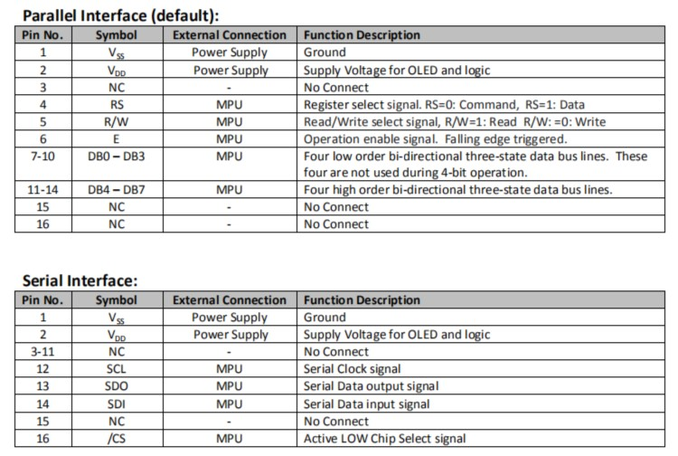
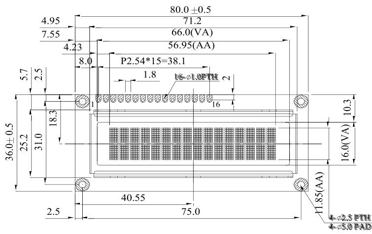
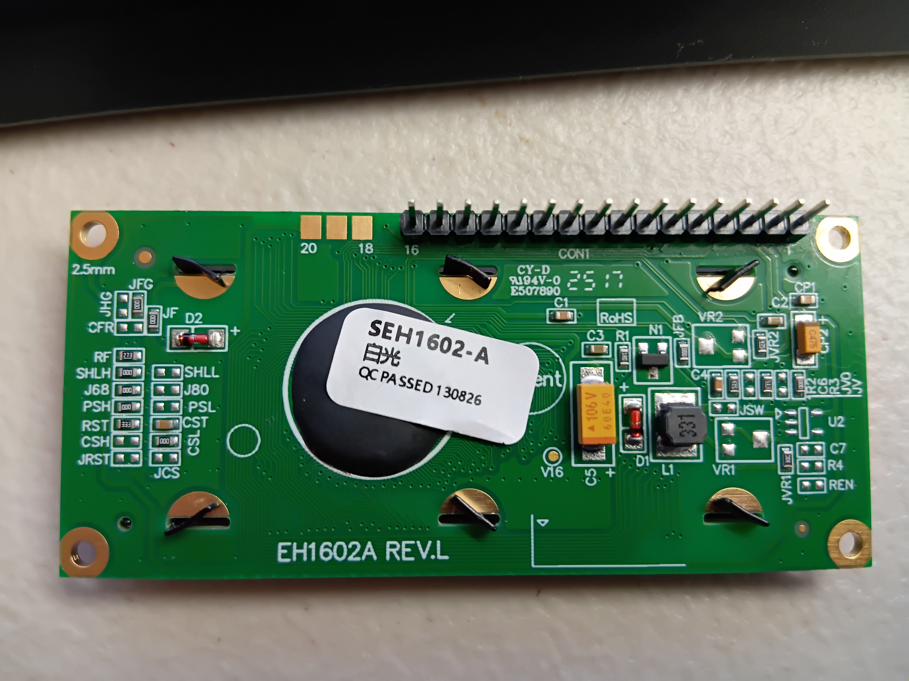

# SEH1602-A OLED: Differences, Power Management, Graphics

2026-11-12

## Overview

The SEH1602-A takes the usual LCD text commands, but it needs its own start-up sequence, slower graphic writes and a 4-bit re-sync to run reliably.

This note covers a PIC 16F1829 at 32 MHz driving it from GCBASIC with `lcd.h`. The controller is a WS0010-TX, according to the vendor's specification text (see "Vendor specification" below).

| Setting | Value |
| --- | --- |
| Interface | `LCD_IO 4` (4-bit), `LCD_NO_RW` (RW not wired, so no busy flag) |
| Control pins | RS = RA0, Enable = RA1 |
| Data pins | DB4 = RA2, DB5 = RC0, DB6 = RC1, DB7 = RC2 |
| OLED init | **`#DEFINE LCD_OLED1602`** (block in `lcd.h`, runs after the generic init) |
| Width | `#DEFINE LCD_WIDTH 16` |

## Differences from a standard LCD

The generic `lcd.h` start-up works only after a power cycle on this OLED, so the init has to force a known state first. The text commands themselves match an HD44780.

| Area | Standard HD44780 LCD | SEH1602-A OLED |
| --- | --- | --- |
| Start-up after MCU reset | Generic wake-up pulses work | Corrupted unless init forces a known state. So, use the **`LCD_OLED1602`** constant. |
| Init sequence | `0x3` pulses, `0x2`, `0x28`, `0x06`, `0x0C`, clear | 300 ms wait; 3 x `0x3` (5 ms apart); `0x2`; `0x28`; `0x08`; `0x01`; `0x06`; `0x17`; `0x0C` |
| Extra command | None | `0x17` = character mode + internal DC-DC on |
| Timing with `LCD_NO_RW` | Library waits are enough | Raw commands need explicit waits: 2 ms per command, 10 ms after clear |
| DDRAM layout | Line 1 at `0x00`, line 2 at `0x40` | Same; 16 characters visible |
| Font tables | One fixed ROM | Four, chosen by FT1:FT0 in `0x28`: 00 English/Japanese (default), 01 Western European I, 10 English/Russian, 11 Western European II (WS0010 datasheet). The vendor listing calls them English/Japanese, West European, Scandinavian European and Cyrillic |
| Custom characters | 8 in CGRAM | 8 in CGRAM (shared with graphic data) |
| Display shift | `0x18` / `0x1C` | Same |
| Graphic mode | None | 100 x 16 pixels, 80 columns visible |

The vendor's own initialisation (module datasheet, `SEH1602-A.pdf`, pages 9 and 10) waits **500 ms** after power on. For the 4-bit bus it first synchronises the nibble order by writing the instruction `0000` five times, then sends the function set. The datasheet says this recovers from noise that mixes up the upper and lower four bits, and marks the code "for reference only". The `LCD_OLED1602` block in `lcd.h` uses a 300 ms wait and 3 x `0x3` then `0x2`, and works on this unit. The vendor sequence is the alternative to try if a warm restart ever misbehaves.

## Power management

The OLED has an internal DC-DC converter that firmware can switch off, so a program can darken the panel without cutting the supply. The commands below are the WS0010 datasheet's graphic/power instruction (`0001 G/C PWR 1 1`: G/C = 1 graphic, PWR = 1 internal power on), and demo 6 exercises them.

| Command | Effect |
| --- | --- |
| `0x17` | Character mode, DC-DC on (set by the init) |
| `0x13` | Character mode, DC-DC off: panel goes dark |
| `0x1F` | Graphic mode, DC-DC on |
| `0x08` / `0x0C` | Display off / on; contents stay in DDRAM |

Demo 6 (`DemoPower` in `oled_ws0010_test.gcb`) shows "Power off in 2s", sends `0x13`, waits 2 s, then sends `0x17`. It waits 100 ms for the DC-DC converter to start before it clears and writes again.

- Send home (`0x02`) and a clear before writing, so a leftover display shift does not move the text.
- Do not leave a static image on the panel for long. Use `0x13` or a blank display as a screensaver; the calculator code already has a timeout for this.
- Whether the panel goes visibly dark on `0x13` has not been reported for this module.

## Graphics

Graphic mode gives a bitmap of 2 pages x 8 rows = 16 pixel rows. Only about 80 of the controller's 100 columns are visible on this 16-character panel, so the usable area is 80 x 16 pixels.

| Command | Meaning |
| --- | --- |
| `0x1F` | Enter graphic mode (DC-DC on) |
| `0x40` + page | Select page 0 (top) or 1 (bottom) |
| `0x80` + column | Set the column (0 to 99, only the first ~80 visible) |
| Data byte (RS = 1) | One column of 8 vertical pixels; the column then advances |
| `0x17` | Return to character mode |

The WS0010 datasheet ("Graphic mode addressing", PDF page 20) gives the addressing: the X address is set with the DDRAM address instruction (`0x80` + column, 100 columns), and the Y address with the CGRAM address instruction (`0x40` + page 0 or 1).

Three things are needed for stable graphics on this unit:

1. **Slow writes:** wait 200 us after each graphic data byte. With 50 us, later character text was corrupted.
2. **4-bit re-sync on exit:** before returning to text, repeat the init pulses (3 x `0x3`, then `0x2`) and send `0x28`, `0x08`, `0x01`, `0x06`, `0x17`, `0x0C`. The test program does this in the method `OLED_Resync`.
3. **Rebuild custom characters:** `MakeBarChars` is called again after leaving graphic mode, because graphic data appears to share CGRAM.

The visible width was measured with the ruler: 8 full-height ticks (columns 0 to 70) were visible and column 80 was not. The constant `GfxRight = 79` is the last visible column and works in the test program. The left edge may start about 2 pixels in.

The oscilloscope program uses these limits: 80 samples per sweep, 16 rows, rising-edge trigger at mid level, dotted centre line. It assumes bit 0 is the top row of each page (`BIT0_TOP`); that orientation has not been checked on the panel yet.

## The four demo programs

All four are in this folder, use the same pin configuration, and compile with the GC Studio Make HEX command.

| Program | What it shows | Result |
| --- | --- | --- |
| `oled_ws0010_test.gcb` | Six demos in a loop: text, bar graph (custom characters), four font tables, display shift, graphic mode (frame, progress bar, checkerboard), DC-DC power off | Text and graphics work after the 200 us write wait and `OLED_Resync`; `GfxRight 79` fits the panel |
| `oled_ddram_probe.gcb` | Writes markers at DDRAM `0x00`, `0x10`, `0x14`, `0x20`, `0x40` | Only `M00` and `M40` were visible: normal 16x2 layout |
| `oled_gfx_ruler.gcb` | Graphic-mode test pattern: a one-pixel box around the visible 80 x 16 area, and vertical rules from row 3 to row 12 every `RuleStep` columns (currently 9) | An earlier version showed 8 full-height ticks (about 80 columns), and a staircase over columns 70 to 79 showed all 10 steps. The panel has a gap between 5-column character cells, so spacing that is not a multiple of 5 looks uneven |
| `oled_scope.gcb` | Oscilloscope: trigger, 80-sample sweep, graticule, built-in test signal or ADC input AN3 (RA4) | Compiles (9.6% of program memory); display result not yet reported |

## Vendor specification

From the vendor's text and drawings for the SEH1602A-OLED (simair listing, saved page and its images):

- The outline and viewing-area dimensions are the same as a traditional STN 1602 LCD, so it can replace one in an existing product.
- The module has a built-in **WS0010-TX** controller and **4 built-in fonts**: English/Japanese, West European, Scandinavian European and Cyrillic (Russian).
- The product default is a **6800 parallel interface**.

| Item | Value |
| --- | --- |
| Display | 16 characters x 2 lines, no backlight (self-luminous) |
| Driver IC | WS0010-TX |
| Operating voltage | 5 V / 3.3 V in the listing; the module datasheet gives VDD = 5.0 V (4.8 to 5.3 V) and says not to use 3 V or 3.3 V logic I/O when VDD is 5 V |
| Supply current | 31 mA typical, 46.5 mA maximum at 5 V (50% check board) |
| Driving method | 1/16 duty, 1/5 bias |
| Display mode | 10000:1 |
| Operating temperature | -20 to +70 C |
| Storage temperature | -30 to +80 C |
| Module size | 80 (L) x 36 (W) x 10 (H) mm |
| View area | 66.0 x 16.0 mm (module datasheet and drawing); the listing's text table says 64.5 x 16 mm |
| Active area | 56.95 x 11.85 mm |
| Dot size, dot pitch | 0.55 x 0.65 mm, 0.60 x 0.70 mm |
| Character size, pitch | 2.95 x 5.55 mm, 3.6 x 6.3 mm |
| Header | 16 pins, 2.54 mm pitch, 1.0 mm holes |
| Mounting holes (drawing) | 4 x 2.5 mm, 75.0 x 31.0 mm apart, 5.0 mm pads |
| Colours | Yellow, white, blue, red, green |
| Weight | 50 g |

The character pitch (3.6 mm) is 6 times the dot pitch (0.60 mm), so each character cell is 5 dot columns plus one blank column. That is the gap seen between character cells in the graphic-mode photos.

### Pin descriptions

The 16-pin header has two meanings, depending on how the board links are set. Parallel is the default.

| Pin | Parallel (default) | Serial |
| --- | --- | --- |
| 1 | Vss: ground | Vss: ground |
| 2 | Vdd: supply for OLED and logic | Vdd: supply for OLED and logic |
| 3 | NC | NC |
| 4 | RS: 0 = command, 1 = data | NC |
| 5 | R/W: 1 = read, 0 = write | NC |
| 6 | E: falling edge triggered | NC |
| 7 to 10 | DB0 to DB3 (not used in 4-bit operation) | NC |
| 11 to 14 | DB4 to DB7 | 11 NC; 12 SCL (serial clock); 13 SDO (serial data out); 14 SDI (serial data in) |
| 15 | NC | NC |
| 16 | NC | /CS: active low chip select |

Your current wiring is the parallel 4-bit case: RS = pin 4, E = pin 6, DB4 to DB7 = pins 11 to 14, and R/W (pin 5) not driven because of `LCD_NO_RW`.

The vendor's own pin tables:

### Dimensions

## Changing to SPI

The vendor's instruction is to remove the resistors at `PSH`, `J68` and `CSL`, and at the same time solder 0 ohm resistors at `PSL` and `JCS`. The vendor adds: "If you need SPI LCD, please contact us!"

On the back of the board (an `EH1602A REV.L`, from a photo of this unit):

| Position | State in the photo | Change for SPI |
| --- | --- | --- |
| `PSH` | "000" part fitted | Remove |
| `J68` | "000" part fitted | Remove |
| `CSL` | "000" part fitted | Remove |
| `PSL` | empty | Fit 0 ohm |
| `JCS` | empty | Fit 0 ohm |

- `lcd.h` has no direct SPI mode for this display. `LCD_IO 14` and `LCD_IO 16` drive a port expander (MCP23S17 or PIC16LF72), not the display controller.
- In serial mode the header becomes: pin 12 = SCL, pin 13 = SDO, pin 14 = SDI, pin 16 = /CS (active low). See the pin table above.
- The plan for a serial driver is in `SPI_Library_Project_Note.md`.

The vendor's own picture of the change, from a Winstar board (`WEH001602AWPP5N00100`, `EH1602A REV.K`): remove the `J68` resistor, move the `PSH` resistor to `PSL`, and move the `CSL` resistor to `JCS`. Your board is a REV.L, so check the silkscreen before changing anything.

### Serial interface timing

From the IST0010 specification (`IST0010.pdf`, "3-line serial write cycle", pages 43 to 44 and "Serial Interface Characteristics", page 51) and the WS0010 specification (page 35). The IST0010 is the same family of controller as the WS0010, with the same instruction set text, but I have not confirmed it is identical, so check anything critical against the WS0010 pages.

- The chip's serial pins are DB5 = SCL, DB6 = SDO and DB7 = SDI, which are header pins 12, 13 and 14.
- **Clock:** SCL idles high. SDI changes while SCL is low and is sampled on the **rising edge** of SCL.
- **Frame:** /CS (`CSB`) goes low, then RS, R/W (low for a write), then DB7 down to DB0, 10 bits in all. RS = 0 is a command and RS = 1 is a RAM write.
- **Chip select:** for a command or a single RAM write, /CS goes high again after each frame. A continuous RAM write (RS = 1 only) keeps /CS low and sends RS and R/W once, followed by back-to-back data bytes.
- **Reads:** SDO returns a dummy byte first and then the valid data.

| Timing | Symbol | Minimum |
| --- | --- | --- |
| Serial clock cycle | tCYS | 300 ns |
| SCL high pulse width | tWHS | 100 ns |
| SCL low pulse width | tWLS | 100 ns |
| /CS setup time | tCSS | 150 ns |
| /CS hold time | tCHS | 150 ns |
| Data setup time | tDSS | 100 ns |
| Data hold time | tDHS | 100 ns |
| Read access time (SDO) | tACCS | 80 ns maximum |

A bit-banged clock in GCBASIC at 32 MHz (125 ns per instruction) takes several instructions per edge, so it should be slower than the 300 ns minimum. That has not been measured.

## Datasheets and photos

Files in this folder:

| File | What it is |
| --- | --- |
| `SEH1602-A.pdf` | Module datasheet from the vendor (simair), 19 pages: specification, drawing, pin functions, electrical characteristics, and the vendor's initialisation (pages 9 and 10) |
| `IST0010.pdf` | IST0010 OLED controller specification, 65 pages, including the serial timing (pages 43, 44 and 51) |
| `datasheets/WS0010_specification_WS-RD-0001.pdf` | WS0010 specification from Winstar, document WS-RD-0001 Rev 001 (21 Oct 2010), 38 pages. Shift and power instruction: PDF page 30. Function set and font tables: page 31. Graphic addressing: page 20. Serial figure: page 37. Downloaded from [sos.sk](https://www.sos.sk/a_info/resource/Winstar/WS0010.pdf) |
| `SPI_Library_Project_Note.md` | Plan for writing a serial (SPI) driver for this module: wiring, protocol, design decisions, phases, risks |
| `SPI modify moethod.JPG` | Vendor picture of the SPI modification on a Winstar board |
| `images/seh1602a_back_view.jpg` | Back of this unit (an `EH1602A REV.L`) |
| `images/ruler_display_photo.jpg` | Display photo with the ruler ticks |
| `images/seh1602a_pin_descriptions.jpg`, `images/seh1602a_dimensions.jpg` | Vendor pin tables and outline drawing from the product listing |

The WS0010 and IST0010 documents describe the controller chip. The SEH1602-A datasheet describes this module.

