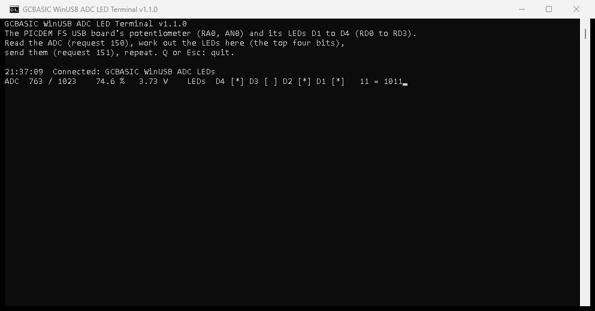

# ADC LED Terminal: a USB comms demonstration

The PC reads the PICDEM FS USB board's potentiometer over USB, works out the LEDs, and sends them back to the board
(PIC18F4550). WinUSB: no driver to install.

## The loop

The PC drives every step; the board only answers.

```
     PC (ADC_LED_Terminal.exe)                        Board (WINUSB_18F4550_ADC_LEDs.gcb)

  1. Request 150 (read)        ------------------->   reads the potentiometer (ReadAD10, AN0)
                               <-------------------   replies: the reading, 2 bytes, low byte first
  2. LEDs = reading / 64   (on the PC: 0 to 15)
  3. Request 151 (write),
     wValue = LEDs             ------------------->   sets D1 to D4 (RD0 to RD3)
  4. Show the line, wait 200 ms, back to 1
```

The board makes no decisions: with no PC, or the terminal closed, the LEDs stay as the PC last set them (all off after
a reset). Change the calculation in step 2 (`Dim Leds = AdcValue \ 64` in `Program.vb`) and the board shows the
change with no new firmware.

## Using it

1. Program the board with `WINUSB_18F4550_ADC_LEDs.gcb` (see [Compile and program](#compile-and-program)).
2. Plug the board into the PC and start `ADC_LED_Terminal.exe`. It waits for the board, then runs the loop five times a
   second and shows one line, updated in place:

```
GCBASIC WinUSB ADC LED Terminal v1.1.0
The PICDEM FS USB board's potentiometer (RA0, AN0) and its LEDs D1 to D4 (RD0 to RD3).
Read the ADC (request 150), work out the LEDs here (the top four bits),
send them (request 151), repeat. Q or Esc: quit.

21:33:37  Connected: GCBASIC WinUSB ADC LEDs
ADC  765 / 1023    74.8 %   3.74 V    LEDs  D4 [*] D3 [ ] D2 [*] D1 [*]   11 = 1011
```

3. Turn the potentiometer: the reading changes, and the LEDs on the board and on the line count with it.

| On the line | What it is |
|---|---|
| `ADC  765 / 1023` | The reading from the board, 0 to 1023 (10 bits) |
| `74.8 %` | The reading as a part of the range, worked out on the PC |
| `3.74 V` | The reading in volts, for a 5 V supply, worked out on the PC |
| `D4 [*] D3 [ ] D2 [*] D1 [*]` | The LEDs the PC sent: `[*]` on, `[ ]` off |
| `11 = 1011` | The LEDs as a number, 0 to 15, and in binary (D4 to D1) |

- Unplug the board: the terminal says "The board was removed." and waits; plug it in again and it carries on.
- **Q** or **Esc** quits.
- With its output to a file or a pipe (`ADC_LED_Terminal.exe > log.txt`), the terminal writes a timed line for each
  new reading instead of one line in place.



## The board

| | |
|---|---|
| Board | PICDEM FS USB Demo Board, 2004, PIC18F4550, 20 MHz crystal |
| Potentiometer | RV1 on RA0 (AN0), read with `ReadAD10`: 0 to 1023 |
| LEDs | D1, D2, D3, D4 on RD0, RD1, RD2, RD3 |

The firmware's main loop is empty: both requests are answered in the USB interrupt (`SetupHandler_CallBack`, called by
GCBASIC's `usb.h`). Request 150 reads the potentiometer when the PC asks, so the reading is always fresh.

## USB

| | |
|---|---|
| USB ID | 04D8:0052, bcdDevice 0x0200 |
| Product name | "GCBASIC WinUSB ADC LEDs" |
| WinUSB device interface GUID | `{C1060DC6-E7CA-4011-AA82-B63E9A555A20}` |
| Request 150, read | bmRequestType 0xC2 (194). Replies with two bytes: the reading, a Word, low byte first |
| Request 151, write | bmRequestType 0x42 (66), no data. The LEDs, 0 to 15 (D1 the lowest bit), in wValue's low byte |
| Request 255, read | The keep-alive: answers 255 |

The firmware reads wValue's low byte from `USBTempBuffer(2)`, where `usb.h` keeps the setup packet.

The bcdDevice and the GUID are this solution's own: the WinUSB Demo Program (bcdDevice 0x0100) does not open this
board, and the terminal does not open the demonstration programs.

## Compile and program

As GC Studio does: F6 (Make HEX), then F5 or Flash Previous with the programmer in `use.ini`. From a command prompt,
in `C:\GCstudio\gcbasic`:

```
GCBASIC.EXE "<path>\WINUSB_18F4550_ADC_LEDs.gcb" /NP /S:use.ini /F:N /P: /DO    (compile)
GCBASIC.EXE "<path>\WINUSB_18F4550_ADC_LEDs.gcb" /NP /S:use.ini /FO /DO         (program the HEX)
```

1,380 words of program memory and 656 bytes of RAM (GCBASIC build 1660).

## Files

| File | What it is |
|---|---|
| `WINUSB_18F4550_ADC_LEDs.gcb` | The firmware, version 1.1 |
| `ADC_LED_Terminal.exe`, `LibUsbDotNet.dll` | The terminal, version 1.1.0, ready to run (.NET Framework 4) |
| `ADC_LED_Terminal.png` | The terminal's window, as above |
| `PC_Application\` | The terminal's source: VB.NET, `ADC_LED_Terminal.sln`, built with Visual Studio 2017. It uses `..\..\LibUsbDotNet.dll`; build from a local copy (MSBuild refuses a network drive's files). |

## Tested

2026-10-25, on the PICDEM FS USB board with the PIC18F4550, programmed with the PICKitPlus: the terminal reads
763 to 766 (request 150), sends LEDs 11 (1011) (request 151) and both transfers succeed, five times a second.
