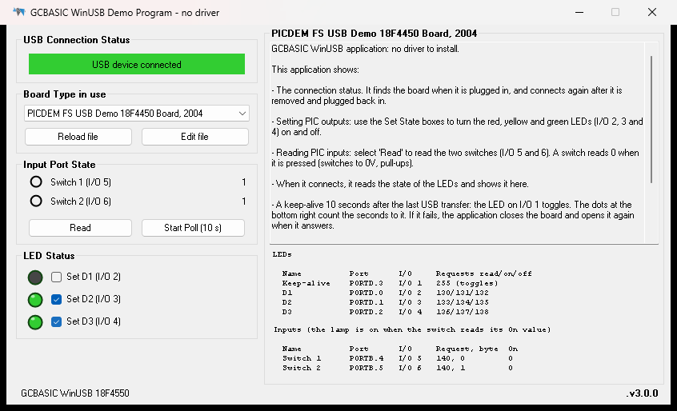
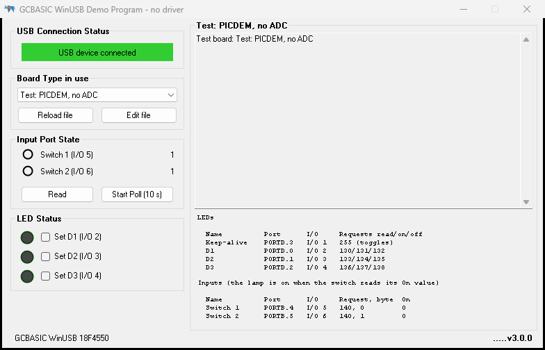
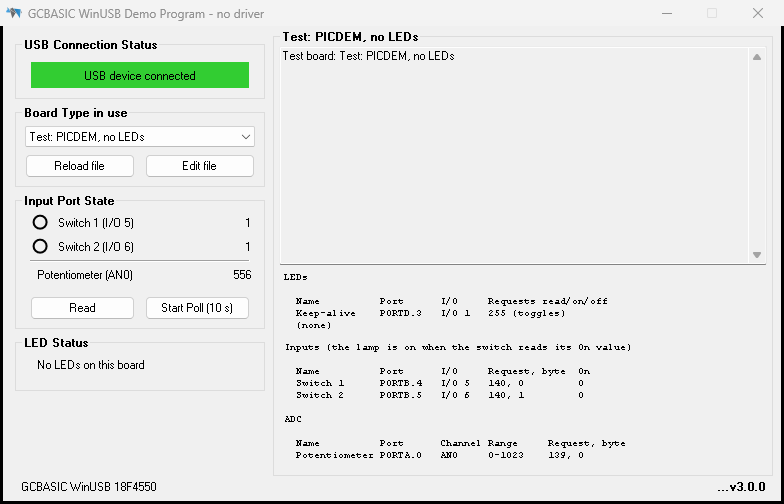
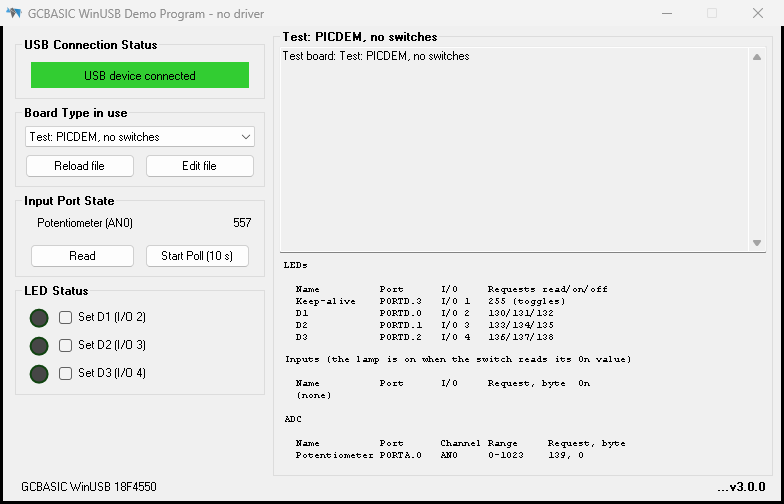
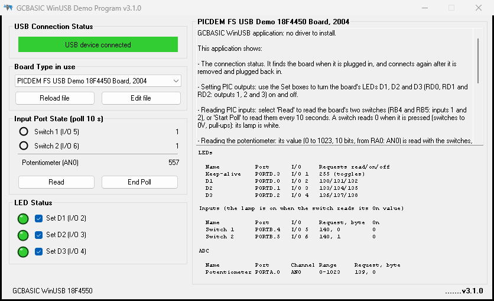
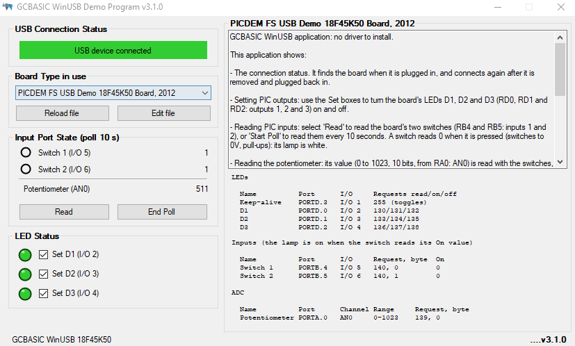

# GCBASIC WinUSB demonstration: no driver to install

Plug a PIC board into the PC, start `WINUSB_DEMO_PROGRAM.exe`, and control the board's LEDs and read its switches
over USB. Windows 8.1 and later load their own WinUSB driver for the board: there is no driver to install.

Everything about a board (its LEDs, switches, pins, USB request codes and help text) is in one file,
`BoardTypes.json`. The PC program builds its window from that file, and writes the firmware's pin header from it.

## Using the PC program



### Start

1. Program the board with its HEX (see [The boards](#the-boards)) and plug it in.
2. Start `WINUSB_DEMO_PROGRAM.exe`.
3. The first time, the program writes `BoardTypes.json` next to itself and asks for the **Board Type in use**.
   The board that is plugged in is already selected: select **OK**. The program remembers the choice.
4. **USB Connection Status** turns green: "USB device connected". The LED and switch states are read from the board.

### The controls

| Control | What it does |
|---|---|
| **USB Connection Status** | Green: the board is connected. Flashing red: the program is looking for it. Unplug and plug in again at any time: the program finds the board again. |
| **Board Type in use** | The boards in `BoardTypes.json`, by name. Select the board you have; the window changes to its LEDs, switches and help. |
| **Reload file** | Read `BoardTypes.json` again, after you change it. |
| **Edit file** | Open `BoardTypes.json` in Notepad. |
| **Input Port State** | One row per switch: a lamp and the value read. A white lamp: the switch is on (pressed). A black ring: off. Below a line, one row per ADC channel (the PICDEM board's potentiometer): its value, 0 to 1023 for 10 bits. Hover over a row for its pin, channel, range and request code. |
| **Read** | Read the switches and the ADC channels now. They are also read when the board connects. |
| **Start Poll (10 s)** / **End Poll** | Read the switches and the ADC channels every 10 seconds (the period is in the board file) until End Poll. Polling never starts by itself, and stops when the board is unplugged or another board is selected. |
| **LED Status** | One row per LED: a lamp in the LED's colour, and **Set** to turn it on or off on the board. |
| **On the right** | The board's name, its help text, and its pin tables: each LED and switch with its port, I/O and USB request codes. |
| **Status line** (bottom left) | The board's USB name, e.g. "GCBASIC WinUSB 18F4550". In red when the board plugged in is not the board type selected. |
| **Dots** (bottom right) | Count the seconds to the next keep-alive: every 10 seconds the program checks the board is still there, and the board toggles its keep-alive LED. |
| **Ctrl+G** | Write the firmware header for the selected board (see [The firmware header](#the-firmware-header-ctrlg)). |

The window opens where it was last closed (always fully on a screen), and widens to fit the longest board name.

### When something is wrong

| You see | What to do |
|---|---|
| "USB device not connected" (flashing) | Check the cable; check Device Manager shows "GCBASIC WinUSB <chip>" under Universal Serial Bus devices. |
| The status line is red: "not the board type in use" | Select the board you have in **Board Type in use**. |
| A message: "BoardTypes.json cannot be used ... at line n, column m" | Correct the file there (**Edit file**), then **Retry**; or **Cancel** to use the built-in boards. |
| A message listing problems in the file | The file loaded, but some entries were ignored or are wrong: the message names the board and field. |
| A switch or ADC value shows "-" | The board did not answer the read: check the board's firmware is the one for the board type selected. |

## The boards

| Board type (name in the program) | Firmware (`WINUSB_<chip>_Demonstration.gcb`) | Keep-alive LED | LEDs | Switches | ADC |
|---|---|---|---|---|---|
| PICDEM FS USB Demo 18F4450 Board, 2004 | `18F4550` (20 MHz crystal) | RD3 | D1 RD0, D2 RD1, D3 RD2 | RB4, RB5 | potentiometer RA0 (AN0), 10 bits |
| PICDEM FS USB Demo 18F45K50 Board, 2012 | `18F45K50` (internal oscillator) | RD3 | D1 RD0, D2 RD1, D3 RD2 | RB4, RB5 | potentiometer RA0 (AN0), 10 bits |
| PIC18F14K50, 12 MHz crystal, one switch | `18F14K50` | RC0 | red RC1, yellow RC2, green RC3 | RA3 | |
| PIC16F1459, internal oscillator, one switch | `16F1459` | RC0 | red RC1, yellow RC2, green RC3 | RA4 | |
| PIC16F1455, internal oscillator, one switch | `16F1455` | RC0 | red RC1, yellow RC2, green RC3 | RA4 | |
| PIC16F1454, internal oscillator, one switch | `16F1454` | RC0 | red RC1, yellow RC2, green RC3 | RA4 | |
| PIC18F Starter Kit 1 (18F46J50), LEDs on the OLED | `18F46J50` | on the OLED | on the OLED | MENU (RB0) | |

- The switches are to 0V with pull-up resistors: they read 0 when pressed.
- The HEX of each is in `WINUSB_<chip>_Demonstration.build\`. Compile with GCBASIC as usual (F6 in GC Studio).
- PICDEM board: RB6 and RB7 are the ICSP clock and data, and read 0 while the PICKit is attached.
- Starter Kit: the kit has no user LEDs, so the LEDs are circles on its OLED (filled when on), with the USB state and
  the MENU button. The program is standalone: programming it replaces the kit's bootloader. It also builds for the
  18F47J53 with only its `#chip` line changed. The bootloader version (`WUSB_GCB.gcb`, `WUSB_GCB.HEX`, version 2.0)
  is in `\\192.168.0.248\iso\MicroChip\PIC18FStartKit1\2026\GCBASICDemo`.

## BoardTypes.json

### Where it is

- The program reads `BoardTypes.json` from its own folder.
- If there is none, the program writes its built-in template there (the boards above) and asks for the board type.
  The template is `PC_Application\VBProject\BoardTypes.json`, built into the program.
- Edit it with **Edit file** (or any text editor), save, and press **Reload file**: the window changes at once.
- The file is JSON: names and texts in double quotes, a comma between items, no comma after the last item in a list.
  Names of fields can be in any case. Fields the program does not know (like `fieldNotes`) are ignored.

### The shape of the file

```
{
  "schemaVersion": 1,
  "fieldNotes": [ "notes for people editing the file: ignored by the program" ],
  "boards": [
    { one board type },
    { another board type }
  ]
}
```

### One board type, explained

This is the PICDEM board in the template, with what each line means:

```
{
  "id": "PICDEMUSBBOARD18F44502004",           a short name, unique in the file; the program remembers your choice by it
  "name": "PICDEM FS USB Demo 18F4450 Board, 2004",   shown in Board Type in use and above the help text
  "productMatch": "18F4550",                   found in the board's USB name ("GCBASIC WinUSB 18F4550"):
                                               selects this board first, and the status line warns when it is not found
  "headerFile": "WINUSB_18F4550_Demonstration.h",     the file Ctrl+G writes for this board's firmware
  "keepAlive": { "name": "Keep-alive", "io": "I/O 1", "port": "PORTD.3", "usbControl": "USBCONTROLKEEPALIVE" },
                                               the LED the board toggles on every keep-alive (every 10 seconds)
  "switchPollSeconds": 10,                     Start Poll reads the switches this often
  "switches": [
    { "usbControl": "USBCONTROLINPUT1",        the firmware's name for this switch (input 1)
      "name": "Switch 1", "io": "I/O 5",       shown in Input Port State
      "port": "PORTB.4",                       the pin
      "usbCode": 140,                          the request that reads the switches
      "replyByte": 0,                          which byte of the answer is this switch (0 = the first)
      "onValue": 0 },                          the value that means "on": 0 for a switch to 0V with a pull-up
    { "usbControl": "USBCONTROLINPUT2", "name": "Switch 2", "io": "I/O 6", "port": "PORTB.5",
      "usbCode": 140, "replyByte": 1, "onValue": 0 }
  ],
  "leds": [
    { "usbControl": "USBCONTROLOUTPUT1",       the firmware's name for this LED (output 1)
      "name": "D1", "io": "I/O 2",             shown in LED Status ("Set D1 (I/O 2)")
      "colour": "LimeGreen",                   the lamp's colour in the program
      "port": "PORTD.0",                       the pin
      "usbCodeRead": 130,                      the request that reads the LED (the board answers 0 or 1)
      "usbCodeOn": 131,                        the request that turns it on
      "usbCodeOff": 132 },                     the request that turns it off
    ...
  ],
  "adc": [                                     ADC channels: the potentiometer
    { "usbControl": "USBCONTROLADC1",          the firmware's name for it (ADC channel 1)
      "name": "Potentiometer", "io": "RV1",    shown in Input Port State
      "port": "PORTA.0", "channel": "AN0",     its pin, and its ADC channel
      "range": "0-1023",                       10 bits: the firmware reads it with ReadAD10
      "usbCode": 139,                          its own request: the board answers two bytes, low byte first
      "replyByte": 0 }
  ],
  "bodyText": [                                the help text on the right, one string per line ("" for an empty line)
    "GCBASIC WinUSB application: no driver to install.",
    ...
  ]
}
```

### Every field

Board fields:

| Field | Needed? | What it is | When left out |
|---|---|---|---|
| `id` | Yes | A short name, unique in the file. Letters, digits and `_` are best. | The board is ignored (with a message). |
| `name` | No | The name shown in the program. | The `id`. |
| `productMatch` | No | Text in the board's USB product name ("GCBASIC WinUSB " + the chip), or a list of texts: `[ "18F46J50", "18F47J53" ]`. | The `id`. |
| `headerFile` | No | The firmware header Ctrl+G writes. | `<id>.h` |
| `keepAlive` | No | The keep-alive LED: `name`, `io`, `port`, `usbControl` (always `USBCONTROLKEEPALIVE`). | No keep-alive LED in the tables or the header. |
| `switchPollSeconds` | No | Seconds between reads while polling, 1 to 3600. 0: no Start Poll. | 0 |
| `switches` | No | Up to 4 switches (below). | No switches. |
| `leds` | No | Up to 8 LEDs (below). | No LEDs. |
| `adc` | No | Up to 4 ADC channels (below). | No ADC channels. |
| `bodyText` | No | The help text: a list of lines, or one text with `\n` for new lines. | Empty. |

A switch:

| Field | What it is | When left out |
|---|---|---|
| `usbControl` | `USBCONTROLINPUT1` to `USBCONTROLINPUT4`: the firmware's name for it. Its number - 1 must be its `replyByte`. | Numbered in order. |
| `name`, `io` | Shown in the program, e.g. "Switch 1 (I/O 5)". | "Switch n", none |
| `port` | The pin, e.g. `PORTB.4`. | |
| `usbCode` | The request that reads the switches: 140 in the firmware. | (a message) |
| `replyByte` | Which byte of the answer: the firmware answers four bytes, inputs 1 to 4 (0 to 3). | Its place in the list |
| `onValue` | The value shown as on (a white lamp): 0 for a switch to 0V with a pull-up, 1 for a switch to the supply. | 1 |

An LED:

| Field | What it is | When left out |
|---|---|---|
| `usbControl` | `USBCONTROLOUTPUT1` to `USBCONTROLOUTPUT8`: the firmware's name for it. | Numbered in order. |
| `name`, `io` | Shown in the program: "Set name (io)". | "LED n", none |
| `colour` | The lamp's colour: a .NET colour name (`Red`, `Gold`, `LimeGreen`, `DodgerBlue` ...) or `#RRGGBB`. An unknown name is lime green. | `LimeGreen` |
| `port` | The pin, e.g. `PORTD.0`. Something that is not a pin (`OLED`) is fine: the header then has only the codes. | |
| `usbCodeRead`, `usbCodeOn`, `usbCodeOff` | The three request codes, 0 to 255, each used once on the board. Not 255 (the keep-alive) or 32 (Windows' WCID request). | (a message) |

An ADC channel (the PICDEM boards have one: the potentiometer):

| Field | What it is | When left out |
|---|---|---|
| `usbControl` | `USBCONTROLADC1` to `USBCONTROLADC4`. | Numbered in order. |
| `name`, `io` | Shown in Input Port State. | "ADC n", none |
| `port`, `channel` | The pin, and its ADC channel: `AN0`, or `ANA0` on chips that name them so. | |
| `range` | `0-255` (8 bits), `0-1023` (10 bits) or `0-4095` (12 bits). | `0-255` |
| `usbCode` | Its own request code: the firmware answers each channel on its own request (139 for the PICDEM potentiometer). | (a message) |
| `replyByte` | 0: the reading is the whole answer, low byte first when more than 8 bits. | 0 |

### Common changes

- **Rename a board, an LED or a switch:** change its `name`, save, **Reload file**.
- **A board with other pins:** change the `port` fields, then Ctrl+G and compile its firmware (the pins are in the
  header, not in the program).
- **Add a board:** copy a board entry (from `{` to `},`), give it a new `id`, `name`, `productMatch` and `headerFile`,
  change its pins, save and **Reload file**. Then select it, press Ctrl+G, and compile a copy of a
  `WINUSB_<chip>_Demonstration.gcb` that includes the new header (change its `#chip` and `#config` for the chip).
- **Add an LED:** add an entry to `leds` with the next `USBCONTROLOUTPUTn`, its own three request codes, and its pin;
  then Ctrl+G and compile.
- **Add a switch:** add an entry to `switches` with a free `USBCONTROLINPUTn` and `replyByte` n - 1; then Ctrl+G and
  compile.
- **Add an ADC channel:** add an entry to `adc` with a free `USBCONTROLADCn`, its pin and `channel`, its `range`, its
  own request code and `replyByte` 0; then Ctrl+G and compile. See [Adding an ADC channel](#adding-an-adc-channel).

## The firmware header (Ctrl+G)

Select the board, press **Ctrl+G**, and save: the program suggests the board's `headerFile` in its own folder, and
lists anything the firmware cannot do as the file says (a `replyByte` that is not the input's number - 1, or a request
code used twice or reserved). The header has:

| Name | What it is |
|---|---|
| `USBCONTROLOUTPUTn`, `_LAT`, `_READ`, `_ON`, `_OFF` | An LED: its pin, its LAT bit and its request codes. An LED that is not a pin has only its codes. |
| `USBCONTROLINPUTSTATUS`, `USBCONTROLINPUTn` | The request that reads the switches, and each switch's pin |
| `USBCONTROLKEEPALIVE` | The keep-alive LED's pin |
| `USBCONTROLADCn`, `_REQUEST`, `_BITS`, `_PIN` | An ADC channel (`AN0`), its request code, its bits (8, 10 or 12) and its pin (set as an input) |
| `USBControlInit` | The pin directions, run at startup by `#startup USBControlInit, 90` (before USB starts) |

Do not edit the header: change the board file and generate it again.

Each firmware program includes its header and handles only the names it defines, so a board with fewer LEDs or
switches needs no change to the program. Request 140 always answers four bytes, inputs 1 to 4, with 1 for an input
the board does not have. Each program keeps its own chip set-up (configuration words, and `ACTCON = 0x90` on the
16F145x). The Starter Kit program keeps its LED states for the OLED, and calls `USBControlInit` itself
(`StartupMethodsDisabled`).

## Adding an ADC channel

The PICDEM boards' potentiometer is the example: RA0, channel AN0, 10 bits, request 139.

**1. The board file.** Add the channel to the board's `adc` list (see [Every field](#every-field)):

```
"adc": [ { "usbControl": "USBCONTROLADC1", "name": "Potentiometer", "io": "RV1",
           "port": "PORTA.0", "channel": "AN0", "range": "0-1023", "usbCode": 139, "replyByte": 0 } ],
```

- `range` sets the bits: `0-255` 8 bits, `0-1023` 10 bits, `0-4095` 12 bits (only on chips with a 12-bit ADC).
- `usbCode` must be the channel's own: not used by an LED or the switches, not 255 (keep-alive) or 32 (WCID).
- Press **Reload file**: the channel's row appears in Input Port State, under the switches.

**2. The header (Ctrl+G).** The header gets:

```
#define USBCONTROLADC1              AN0
#define USBCONTROLADC1_REQUEST      139
#define USBCONTROLADC1_BITS         10
#define USBCONTROLADC1_PIN          PORTA.0
```

and `Dir USBCONTROLADC1_PIN In` in `USBControlInit`.

**3. The firmware.** Nothing to change: each `WINUSB_<chip>_Demonstration.gcb` (not the Starter Kit's) answers
`USBCONTROLADC1` to `4` when the header defines them:

```
#ifdef USBCONTROLADC1
      Case USBCONTROLADC1_REQUEST
        #if USBCONTROLADC1_BITS = 10
            USBControlADCValue = ReadAD10( USBCONTROLADC1 )
            USBBufferWrite( USBControlADCValue )        'a Word: its low byte, then its high byte
        #endif
        ...
#endif
```

- GCBASIC's `ReadAD`, `ReadAD10` and `ReadAD12` set up the ADC for the channel on each read, and put the pins back to
  digital afterwards (on the 18F4550: the PCFG bits), so the switches on RB4 and RB5 (AN11, AN9) stay digital.
  There is no ADC configuration to write.
- `USBBufferWrite` of a Word writes two bytes, low first; `ReadAD` (8 bits) returns a Byte, and writes one.

**4. Compile and program** as GC Studio does: F6 (Make HEX), then F5 or Flash Previous to program it with the
programmer in `use.ini`. From a command prompt, in `C:\GCstudio\gcbasic`:

```
GCBASIC.EXE "<path>\WINUSB_18F4550_Demonstration.gcb" /NP /S:use.ini /F:N /P: /DO    (compile)
GCBASIC.EXE "<path>\WINUSB_18F4550_Demonstration.gcb" /NP /S:use.ini /FO /DO         (program the HEX)
```

**5. Check it.** Plug the board in and start the PC program: the value shows when it connects. Turn the
potentiometer and press **Read** (or **Start Poll**): the value follows, 0 to 1023.

## A board without LEDs, switches or an ADC

A board has only what its entry in `BoardTypes.json` lists. Leave out `leds`, `switches` or `adc` (or make the list
empty, `[]`) and that part is gone, from the PC program's window and from the firmware: nothing else changes.

This was tested on 2026-10-25 with three copies of the PICDEM 18F4550 board, each without one part. Each copy's header
was generated with Ctrl+G and `WINUSB_18F4550_Demonstration.gcb` compiled with it, unchanged; the PC program ran with
the PICDEM board:

| Left out | The PC program's window | The firmware |
|---|---|---|
| `adc` | Input Port State has the switch rows only (no line, no ADC row). The pin tables have no ADC section. | 1,472 words. It answers the LED requests (130 to 138) and the switches (140); no `ReadAD10` code. |
| `leds` | LED Status says "No LEDs on this board". The LED table has only the keep-alive LED. The switches and the potentiometer work. | 1,496 words. It answers only the switches (140) and the ADC (139); no LED pin is set as an output. The keep-alive LED stays (it is `keepAlive`, not in `leds`). |
| `switches` | Input Port State has the potentiometer only; Read and Start Poll read it. The inputs table says "(none)". | 1,548 words. It answers the LED requests and the ADC; request 140 is not answered, and RB4, RB5 are left as they are. |

No warnings when the headers were generated.

| Without the ADC | Without LEDs | Without switches |
|---|---|---|
|  |  |  |

How it works:

- **The PC program** builds its rows from the lists: an empty list gives no rows, and nothing is ever asked of the
  board for it. A group with nothing in it says so ("No LEDs on this board", "No inputs on this board"). Read and
  Start Poll are available while there is a switch or an ADC channel to read.
- **The header** has `'None` in that part's section, so its `USBCONTROL...` names are not defined, and
  `USBControlInit` sets no direction for its pins.
- **The firmware** handles each name inside `#ifdef`, so code for a part the header does not define is not compiled
  at all: the program gets smaller, and the pins stay free.

When the board file and the firmware disagree:

- **The firmware has a part the board file does not:** harmless; the PC program never asks for it.
- **The board file has a part the firmware does not** (its header was not generated again): the firmware answers that
  request with nothing (a successful transfer of 0 bytes), and the PC program shows "-" for it. Nothing else is
  affected: the board stays connected, and the switches, LEDs and keep-alive work. Generate the header (Ctrl+G),
  compile and program. Tested 2026-10-25: the PICDEM board with the potentiometer in the board file, programmed with
  firmware built without it: request 139 answered 0 bytes three times, each followed by normal answers to 140, 130
  and 255; the PC program showed "Potentiometer (AN0) -" and stayed connected.

## From coloured LEDs to outputs (version 3.0)

Up to version 2.0 the firmware and the PC program talked about three coloured LEDs: `REDLED`, `YELLOWLED` and
`GREENLED`, with request names such as `USBDEVICESETREDLEDON`. Version 3.0 calls them outputs, numbered:
`USBCONTROLOUTPUT1`, `2`, `3` ... The colour is now only how the PC program draws the lamp.

### Why

- **The colours belonged to one board.** The first board had a red, a yellow and a green LED. The PICDEM FS USB board
  has D1 to D4, the Starter Kit has none (they are drawn on its OLED), and another board may have one blue LED.
  A name like `GREENLED` said nothing true about those boards.
- **The names hid the mapping.** To run on the PICDEM board, a hand-written header had to say
  `REDLED = PORTD.2`, `YELLOWLED = PORTD.1`, `GREENLED = PORTD.0`: three LEDs that are not red, yellow or green, in an
  order that had to be remembered. The PC program called the same LEDs D1, D2, D3.
- **Every program demanded every name.** The firmware used `REDLED`, `YELLOWLED`, `GREENLED` and `INPUT1` to `INPUT4`
  whether the board had them or not. A board with two LEDs, or one switch, did not compile until dummy pins were
  invented for the rest.
- **An output is not always an LED.** The same request (on, off, read back) drives a relay, a buzzer or an enable pin
  just as well. "Output" is what the firmware does; "LED" and its colour are what one board has.
- **One place for the truth.** The PC program already numbered the LEDs in `BoardTypes.json`. With numbered names, the
  board file can say which output is which (`usbControl`), and the firmware's header is generated from it, so the
  PC program and the firmware cannot disagree.

### How

1. **The board file names each item for the firmware.** Each LED, switch and ADC channel in `BoardTypes.json` has a
   `usbControl` name; the board's name for it (`name`, e.g. "D1" or "Red") and its `colour` are only for the PC
   program's window.
2. **The PC program writes the header.** Ctrl+G turns the board's entry into `WINUSB_<chip>_Demonstration.h`: for each
   output its pin, its LAT bit and its three request codes, all under the numbered name.
3. **The firmware uses only numbered names, and only those defined.** Each handler is inside `#ifdef`, so the program
   compiles for a board with any number of outputs (up to 8) and inputs (up to 4), without changes.
4. **The request codes came out of the program.** Version 2.0 had them as constants in each `.gcb`
   (`#Define USBDEVICESETREDLEDON 131`); now they are in the board file and the header (`USBCONTROLOUTPUT1_ON 131`).
   The template keeps the same codes, so the protocol did not change: a 2.0 board still works with the 3.0 PC program
   when its board entry has its pins.

| Version 2.0 name | Version 3.0 name | Notes |
|---|---|---|
| `REDLED`, `REDLED_LAT` | `USBCONTROLOUTPUT1`, `USBCONTROLOUTPUT1_LAT` | output 1 (the template's "Red" or "D1") |
| `YELLOWLED`, `YELLOWLED_LAT` | `USBCONTROLOUTPUT2`, `USBCONTROLOUTPUT2_LAT` | output 2 |
| `GREENLED`, `GREENLED_LAT` | `USBCONTROLOUTPUT3`, `USBCONTROLOUTPUT3_LAT` | output 3 |
| `USBDEVICEREADREDLEDSTATUS` (130) | `USBCONTROLOUTPUT1_READ` | the code comes from the board file |
| `USBDEVICESETREDLEDON` (131) | `USBCONTROLOUTPUT1_ON` | |
| `USBDEVICESETREDLEDOFF` (132) | `USBCONTROLOUTPUT1_OFF` | likewise `..._2_...` (133 to 135), `..._3_...` (136 to 138) |
| `INPUT1` to `INPUT4` | `USBCONTROLINPUT1` to `USBCONTROLINPUT4` | only the board's own switches are defined |
| `USBDEVICERPORTSTATUS` (140) | `USBCONTROLINPUTSTATUS` | |
| `KEEPALIVELED` | `USBCONTROLKEEPALIVE` | |
| `Dir ...` in the program | `USBControlInit`, in the header | runs at startup (`#startup USBControlInit, 90`) |

The `USBCONTROL` prefix keeps the names apart from GCBASIC's and the libraries' own (`usb.h` uses `USB...`), and makes
it plain where a name comes from: the generated header.

The help text (`bodyText`) follows the same idea: each board's text names its own LEDs and switches.

| Board | Its help text says |
|---|---|
| PICDEM FS USB boards (18F4550, 18F45K50) | LEDs D1, D2 and D3 (RD0 to RD2: outputs 1 to 3); the two switches on RB4 and RB5 (inputs 1 and 2), with Read and Start Poll; the keep-alive LED D4 (RD3). The 18F4550 board line names the PICDEM board, its PIC18F4550 and its 20 MHz crystal. |
| Starter Kit (18F46J50) | The red, yellow and green LEDs (outputs 1 to 3) are circles on the OLED, labelled RED, YEL and GRN, filled when on; the MENU button (RB0: input 2), with Read and Start Poll, also shown on the OLED; "USB: connected" on the OLED; the KA circle toggles on the keep-alive. |
| 18F14K50, 16F1459, 16F1455, 16F1454 | The red, yellow and green LEDs (I/O 2, 3 and 4) and the switch (I/O 6): these boards' LEDs are those colours. |

The PICDEM and Starter Kit texts call the LED boxes "Set", as the program labels them; the other boards' texts still
say "Set State" (version 2.0's label). To change a board's text, edit its `bodyText` and press **Reload file**.

## Files

| File | What it is |
|---|---|
| `WINUSB_DEMO_PROGRAM.exe`, `.exe.config`, `LibUsbDotNet.dll` | The PC program (v3.1.0), ready to run. |
| `BoardTypes.json` | The board file the PC program uses. |
| `WINUSB_<chip>_Demonstration.gcb` | The firmware, one per chip. |
| `WINUSB_<chip>_Demonstration.h` | The board's pins and request codes, written by the PC program (Ctrl+G). |
| `gcbversionnumber.cnt`, `.GCB` | The build counter the programs include. |
| `PIC18StarterKit1.h` | The Starter Kit's pins and APP_VDD soft start, for the 18F46J50 program. |
| (`usb.h`) | GCBASIC's own `include\usb.h` (2026-10-19), with `USB_WCID` and the PIC18 bank fix. |
| `PC_Application\` | The PC program's source (VB.NET, LibUsbDotNet; open `WinUSB_Demo_Program.sln`). |
| `WINUSB_DEMO_PROGRAM_v2.1.0\` | The previous PC program (its boards in its code), kept to compare with. |
| `ADC_LED_Terminal\` | A separate, smaller solution for the PICDEM 18F4550 board: the board shows its potentiometer on its four LEDs, and a terminal shows the reading and the LEDs. See its own [README](ADC_LED_Terminal/README.md). |

## How it works

### USB

```
#define USB_VID 0x04D8
#define USB_PID 0x0052
#define USB_REV 0x0100
#define USB_WCID
#define USB_WCID_GUID "{BFC2B144-FB5A-4F56-98AC-93BC164EED46}"
#include <usb.h>
#include "WINUSB_<chip>_Demonstration.h"
```

- `USB_WCID` adds three answers: the OS string (string index 0xEE, "MSFT100" and the vendor code), the
  Extended Compat ID ("WINUSB") and the Extended Properties (`DeviceInterfaceGUIDs`).
- `USB_WCID_GUID` is required with `USB_WCID`. It must be 38 characters, and each solution needs its own.
- `USB_WCID_VENDOR_CODE` is the request code Windows uses to read the descriptors. It defaults to 0x20; it
  must not be one of the program's own request codes.
- The PC program sends vendor control requests: a request code, and for a read, up to 64 bytes back. The firmware
  answers 255 to request 255 (the keep-alive).
- The firmware's USB product name is "GCBASIC WinUSB <chip>".

### The USB ID

- 04D8 is Microchip's vendor ID: a published solution needs Microchip's permission for a PID under it,
  or a PID of its own from pid.codes (VID 1209).
- The bcdDevice is 0x0100. Windows asks for the OS string only once per VID, PID and bcdDevice, and
  remembers the answer. A device first seen without WCID is not asked again until the bcdDevice changes,
  or until the key `HKLM\SYSTEM\CurrentControlSet\Control\usbflags\04D800520100` is deleted.
- 1209:2006 stays with the LibK solution: the LibK driver's INF matches `VID_1209&PID_2006`.

### Recovery in the PC program

- **Unplug:** the device notification closes the device, and the screen shows "not connected".
- **Plug in again:** the 1 s timer looks for the device and opens it. The LED and switch states are read again.
- **A failed transfer or a wrong keep-alive** (every 10 s): the device is closed and found again.

## Sizes (GCBASIC build 1660)

| Firmware, version 3.1 (the Starter Kit's 3.0) | Program memory | RAM |
|---|---|---|
| 18F4550 (with the ADC) | 1,576 words | 723 bytes |
| 18F45K50 (with the ADC) | 1,793 words | 723 bytes |
| 18F14K50 | 1,471 words | 461 bytes |
| 16F1459 | 1,803 words | 716 bytes |
| 16F1455 | 1,801 words | 716 bytes |
| 16F1454 | 1,796 words | 716 bytes |
| 18F46J50 (Starter Kit) | 4,607 words | 1,917 bytes |

## Tested

| Board | Status |
|---|---|
| PICDEM FS USB board, 18F4550 | Version 3.1 tested on the board, 2026-10-25: enumerates with WinUSB; the PC program sets the LEDs on and off and reads them back, and reads the two switches. The potentiometer (ADC, RA0/AN0, 10 bits) tested on the board, 2026-10-25: the value follows the potentiometer, read on connect, by Read and by Start Poll |
| PICDEM FS USB board, 18F45K50 | Version 3.1 tested on the board, 2026-10-25: enumerates with WinUSB; the PC program sets the LEDs D1 to D3 and reads them back, reads the two switches and the potentiometer (511), and polls them |
| 18F14K50 | Version 2.0 tested on the board (2026-10-19); version 3.1 compiles, not tested |
| 16F1454, 16F1455, 16F1459 | Version 2.0 tested on the boards (2026-10-19); version 3.1 compiles, not tested |
| Starter Kit (18F46J50) | Version 3.0 compiles; not tested on the kit |

The two PICDEM boards with version 3.1, polling, the LEDs on:

| PICDEM FS USB board, 18F4550 | PICDEM FS USB board, 18F45K50 |
|---|---|
|  |  |

To test a board: program its HEX, plug it in (Device Manager: "GCBASIC WinUSB <chip>" under Universal Serial Bus
devices, no driver installed), start the PC program, select the board type, and check the LEDs, the switches (Read,
Start Poll) and the keep-alive LED. Unplug and plug in again: the program connects again.

## History

- **3.1 (2026-10-25):** ADC channels: the PICDEM boards' potentiometer (RA0/AN0, 10 bits, request 139), shown as a
  value in Input Port State and read on connect, by Read and by Start Poll. The header defines the channel's pin and
  sets it as an input; the firmware answers a 10- or 12-bit reading as one Word (3.0 sent its high byte twice). The PC
  program is built with Visual Studio 2017, and keeps the previous version's settings. The Starter Kit program is
  unchanged (3.0).
- **3.0 (2026-10-25):** the boards in `BoardTypes.json`; the firmware's pins in a generated header (Ctrl+G); switch
  lamps and polling; the help text of the PICDEM boards and the Starter Kit rewritten for their own LEDs and switches;
  the 18F45K50 program on the PICDEM board's pins (2.0: LEDs RA4, RA5, RC0, RC1, switches RB4 to
  RB7); only each board's own switches are read (2.0 read four input pins on every board).
- **2.0 (2026-10-19):** WinUSB with no driver (the Microsoft OS descriptors), from the LibK/WinUSB version.
- **1.0:** LibK/WinUSB with a driver (`USB_LIBKWINUSB_18F14K50_Demonstration.gcb`, 1209:2006). The old LibK versions
  (16F145x with ADC values; the 18F45K50 GCBlib demo with an I2C LCD) are still in Demonstration_Sources.git.

## Building the PC program

The PC program (v3.1.0) is built with Visual Studio 2017 (open `PC_Application\WinUSB_Demo_Program.sln`, or
`MSBuild.exe WinUSB_Demo_Program.sln /p:Configuration=Release` from `...\2017\Community\MSBuild\15.0\Bin`), for
.NET Framework 4.0 Client. Build from a local copy of `PC_Application`: on a network drive MSBuild refuses
`MainForm.resx` (error MSB3821, the file is in the Internet zone) unless the share is in Windows' Local intranet zone.
